# BÁO CÁO BÀI TẬP

## THÔNG TIN SINH VIÊN
- **Họ và tên:** Phạm Huy Hoàng
- **Mã số sinh viên:** 24810340415
- **Lớp:** D19CNPM3
- BÀI TẬP 6.6: HỆ THỐNG MDI ĐIỀU HÀNH MẠNG LƯỚI CÂY ATM NGÂN HÀNG (KIẾN TRÚC MDI & ASYNC/AWAIT)

---

## MỤC ẢNH KẾT QUẢ CHỨC NĂNG
### 1. Màn hình Chính / Tổng quan hệ thống:
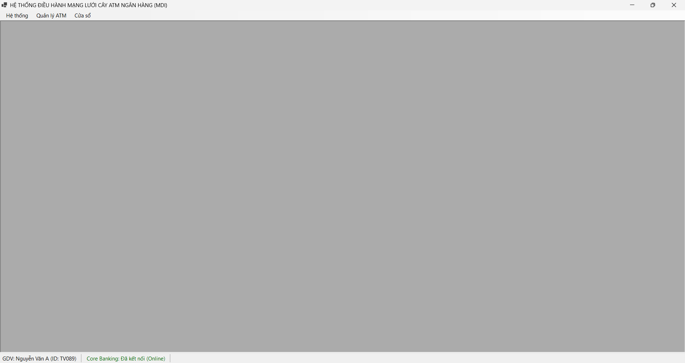
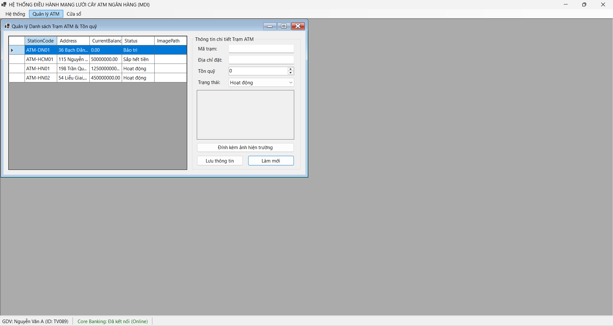
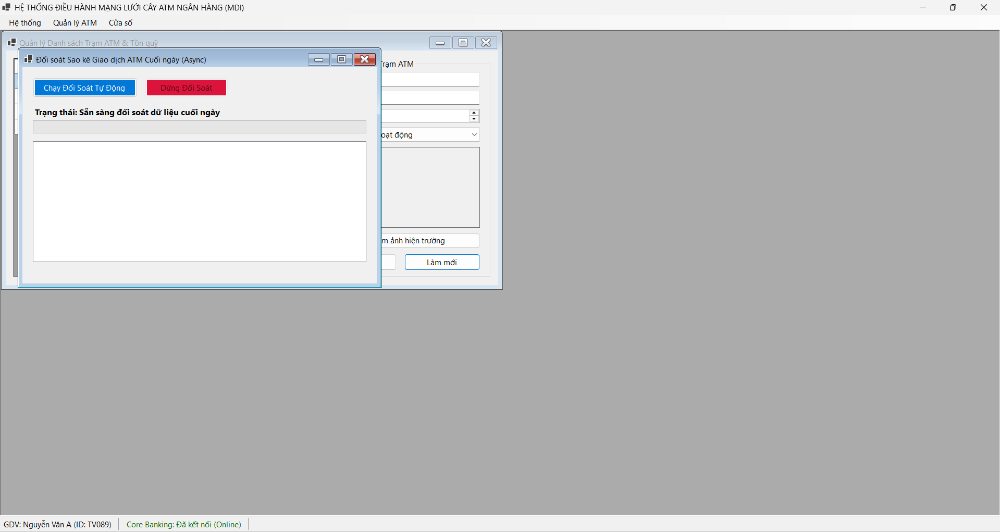

### 2. Màn hình Quản lý Danh mục (CRUD - Thêm/Sửa/Xóa):
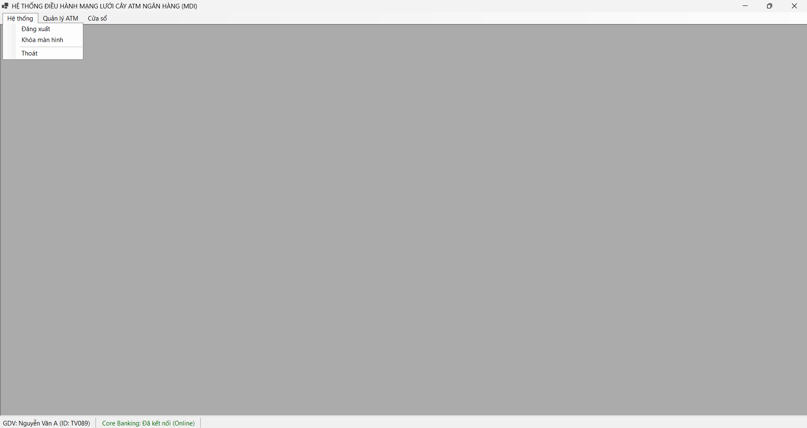
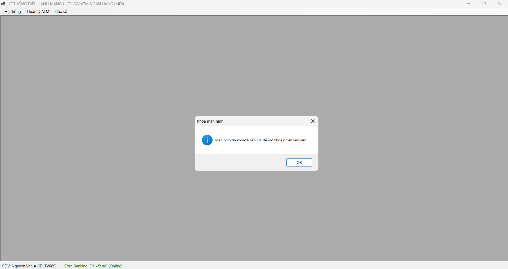
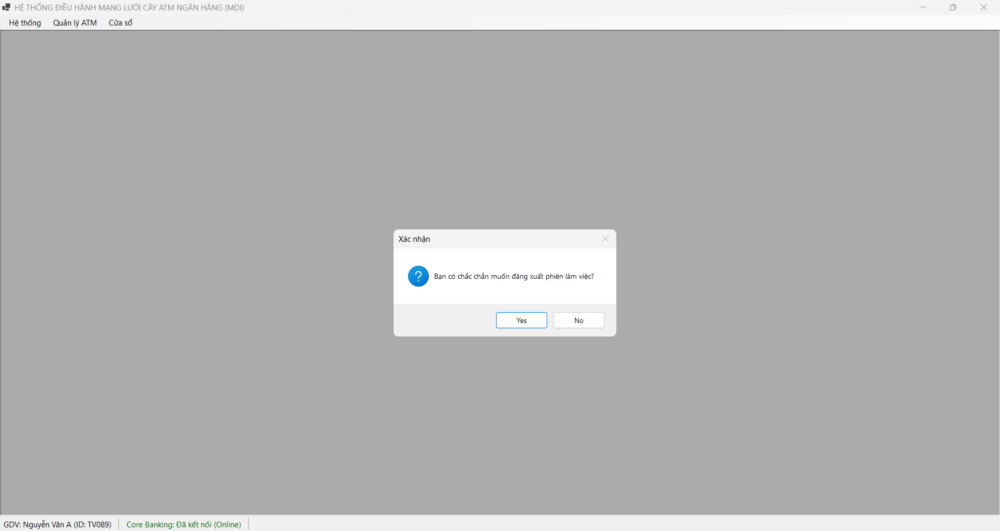

### 3. Màn hình Thực thi Nghiệp vụ chính (Lập Hóa đơn / Bán hàng / Chấm công / Đặt phòng):
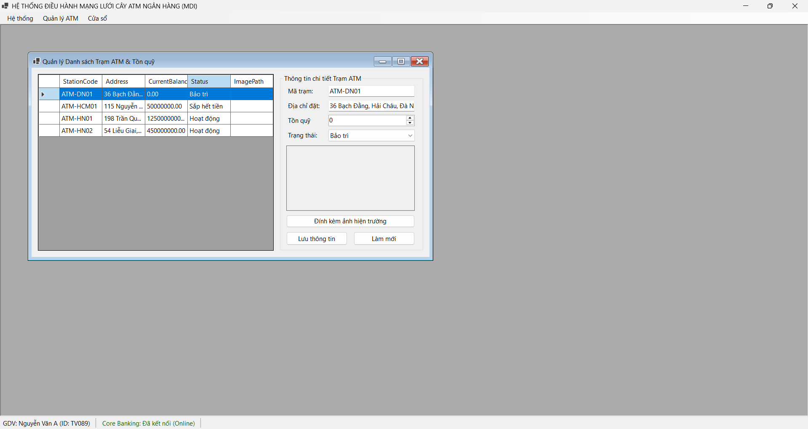
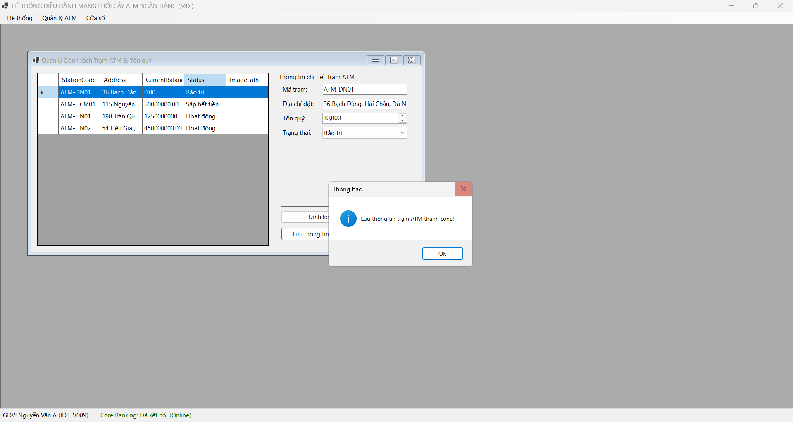

### 4. Màn hình Báo cáo - Thống kê:
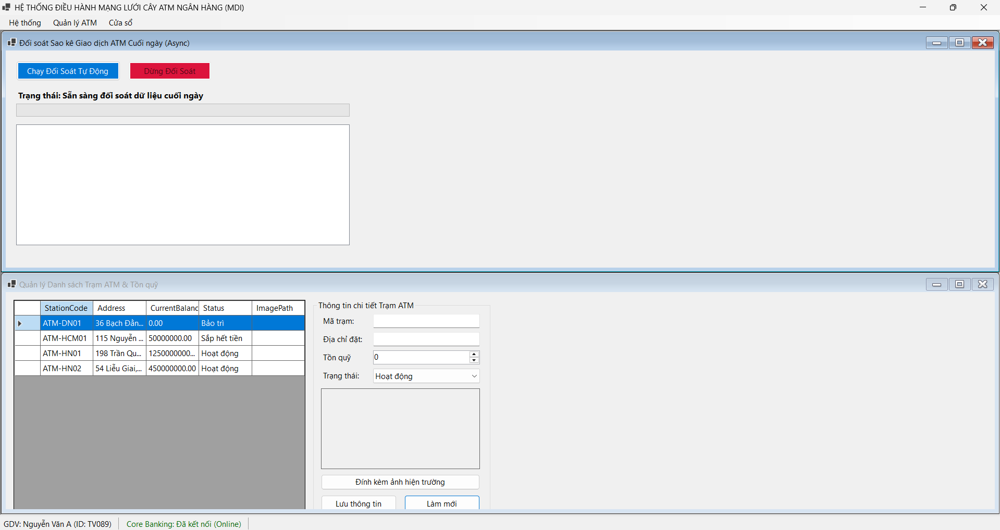
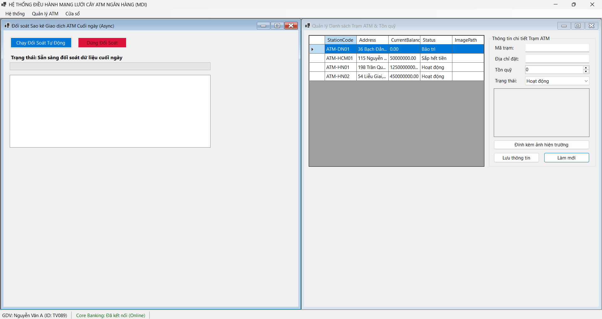
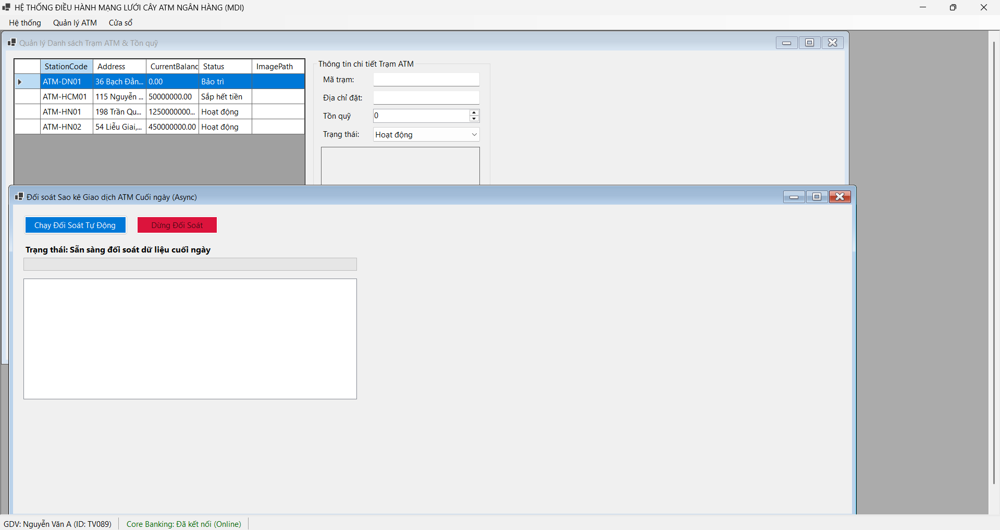

### 5. Minh họa An toàn Dữ liệu (Phòng chống SQL Injection / Báo lỗi Transaction Rollback):

